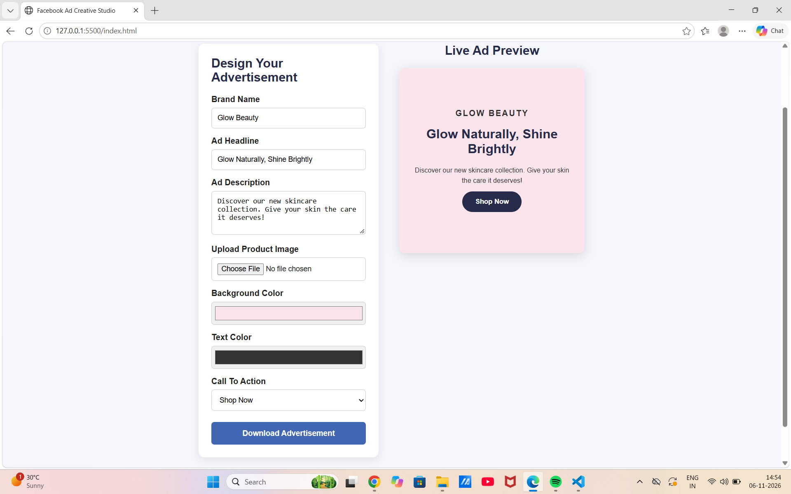

# Facebook Ad Creative Studio

## About the Project

Facebook Ad Creative Studio is a web-based digital
marketing project that allows users to create and
customize social media advertisements.

Users can customize brand names, headlines,
descriptions, product images, background colors,
and call-to-action buttons.

## Features

- Interactive advertisement editor
- Live advertisement preview
- Product image upload
- Custom background and text colors
- Multiple CTA options
- Download advertisement as PNG
- Responsive user interface

## Technologies Used

- HTML5
- CSS3
- JavaScript
- html2canvas

## Project Structure

Facebook-Ad-Creative-Studio/
- index.html
- style.css
- script.js
- README.md
- assets/

## How to Run

1. Download or clone this repository.
2. Open the project in VS Code.
3. Open index.html using Live Server.
4. Customize your advertisement.
5. Download your creative as PNG.

## Learning Outcomes

- Understanding digital advertising creatives
- Practicing frontend web development
- Learning DOM manipulation
- Understanding visual branding
- Creating interactive user interfaces

## Project Type

Personal Portfolio Project

Created for learning and demonstrating
digital marketing and web development skills.
## Project Preview

